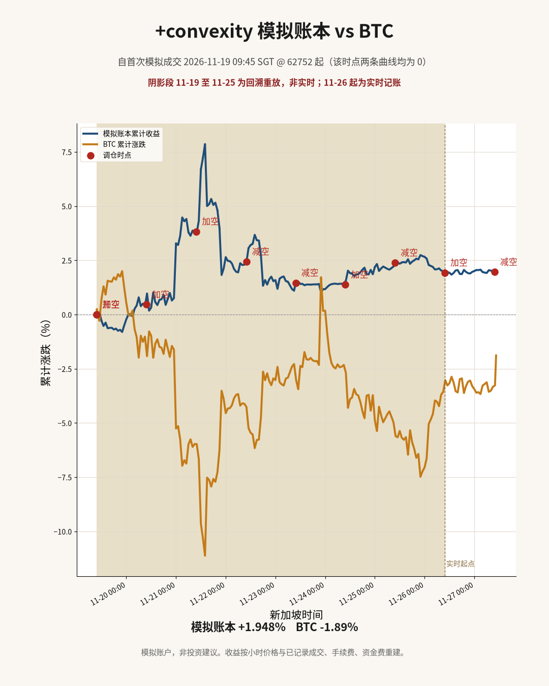

# +convexity 模拟账本

这是一个公开、带时间戳、历史提交可查的**纸面模拟账户**（paper ledger）。它跟踪 Hyperliquid 上公开金库 **+convexity** 的每日调仓，按该金库当时的实际杠杆，在一个虚拟账户里同步开平仓，并把每天的成交和净值追加进本仓库。每一次 Git 提交都带有时间戳，提交之后的历史记录可供任何人核对。

本仓库**不是实盘**，**不是跟投**，也**不是投资建议**。

## 金库地址（可公开查验）

- 名称：`+convexity`
- 地址：`0x5661a070eb13c7c55ac3210b2447d4bea426cbf5`
- 数据来源：Hyperliquid 公开接口 `https://api.hyperliquid.xyz/info`（`clearinghouseState`、`userFillsByTime`、`vaultDetails`、`fundingHistory`、`allMids` 等），免费、无需登录。

任何人都可以用同一组公开接口，核对该金库的成交、仓位和权益。

## 最新摘要

<!-- LEDGER-SUMMARY:START -->
- 更新时间（新加坡时间）：2026-11-27 10:31:44 SGT
- 模拟权益：101,934.79 USD
- 累计收益：+1.9348%
- 当日盈亏：-60.42 USD
- 模拟仓位：BTC:-0.01217
- BTC 中间价：61568.5（近24h +1.31%，自起始日 -1.89%）
- 今日调仓：减空 0.44842 BTC @ 60676

日报全文：[2026-11-27.md](reports/2026-11-27.md) · 可复制文案：[latest_post.txt](reports/latest_post.txt)

**模拟账本 vs BTC**（自首次模拟成交 2026-11-19 09:45 SGT @ 62752 起，该时点两条曲线为 0；11-19 至 11-25 为回溯重放，非实时）


<!-- LEDGER-SUMMARY:END -->

## 模拟规则

- 起始日：2026-11-19（新加坡时间，SGT）
- 起始虚拟本金：100,000 USD
- **2026-11-19 至 2026-11-25 为回溯重放，非实时**；**2026-11-26 起为实时记账**。回溯段在 `trades.csv`、`daily.csv` 的 `note` 栏，以及图表阴影和日报里都有标明。
- 手续费：按成交名义价值收取 0.045% 吃单手续费。
- 成交价：金库当日该币种成交量加权均价（VWAP）。金库当日没有成交，则模拟账户当日也不交易，只做盯市和资金费。
- 资金费：按 Hyperliquid 小时资金费率，对模拟仓位逐小时计提。小时标记价优先用该小时 K 线开盘价。这是近似，不是交易所官方结算单。
- 幂等：同一天重复运行不会重复成交。公开接口失败时以非零状态退出，并且不会提交。

### 如何剔除出入金驱动的调仓

金库每天约 09:45 SGT 调仓。申购会抬高权益、稀释杠杆，下一次调仓里往往有一部分只是按新资金把仓位补回去。模拟账户用独立的 10 万本金，不应该跟着补这一段。拆分规则是：

1. `F` = 上一调仓时点（约 09:45）到本次调仓之间，金库净流入。申购取公开账本里的 `vaultDeposit.usdc`，赎回取 `vaultWithdraw.netWithdrawnUsd`（负数）。
2. `E_pre` = 本次调仓前的金库权益。用早于调仓的最近一次公开权益快照，按当时仓位、小时中间价、出入金和资金费推到调仓前。这是近似。
3. `E_organic` = `E_pre − F`（去掉这段出入金后的有机权益）。若 `E_organic ≤ 0`，则不做拆分，整段成交视为策略仓，并在 `replay_audit.csv` 里标记。
4. 出入金补仓 `scale_delta` = `调仓前仓位 × F / E_organic`。若 `F = 0`，则为 0。
5. 策略目标仓 `S_strategy` = `调仓后仓位 − scale_delta`。
6. 模拟目标仓 = `S_strategy ×（调仓前模拟权益 / E_organic）`，按当日 VWAP 成交差额。

因此模拟仓位跟踪的是「去掉补资金之后的策略杠杆」，不是金库的毛仓位。每日拆分数字见 `replay_audit.csv`，可供核对。

### 起始日建仓方法（2026-11-19）

1. 取 2026-11-19 09:45 SGT 调仓**之前**的金库仓位（当日首笔成交的 `startPosition`，BTC 空 5.73308）。
2. 用上面的方法估计当时金库权益 `E_pre`。
3. 模拟仓位 = 金库当时仓位 ×（100,000 / `E_pre`），在当日金库成交价 **62752** 上开仓（09:45–09:46 SGT 全部成交都是这个价格，即当日 VWAP），并扣除 0.045% 手续费。
4. 然后再按上述规则处理 11-19 当天的策略调仓。

模拟开仓均价是 11-19 的 62752，不是金库账户里更早的历史均价。11-19 至 11-25 的轨迹是事后用公开成交重放的，**不是当时逐日发布的实时记录**。

原先「从 2026-11-26 当天仓位一次性建仓」的版本，作为快照保存在 [`since-2026-11-26/`](since-2026-11-26/)，不再更新。

金库通常在每天 09:45–10:00（新加坡时间）调仓。本账本按这个节奏在调仓之后更新。

## 文件说明


- `trades.csv`：每笔模拟成交（含 `note`：回溯重放，非实时 / 实时）
- `daily.csv`：每日模拟权益、仓位、杠杆、盈亏，以及对照的金库数据（同样有 `note`）
- `replay_audit.csv`：每日出入金拆分（`F`、`E_pre`、`scale_delta`、`S_strategy`），便于核对
- `state.json`：脚本状态，用于续跑和防止同一天重复成交
- `ledger_core.py` / `update.py`：重放与每日更新（Python 3；画图需要 matplotlib 和 Noto Sans CJK）
- `report_charts.py`：每日中文日报、可复制文案和收益曲线图
- `reports/`：每日日报和 `latest_post.txt`
- `charts/pnl_vs_btc.png`：模拟账本 vs BTC（阴影段为回溯重放）
- `since-2026-11-26/`：旧的「从 11-26 一次性建仓」账本快照，不再更新

金库自身更长区间的公开历史图（不是本模拟账本）仍可生成在 `charts/vault_history_vs_btc.png`，如需对照请自行查看，不要把它当成 11-19 起的模拟账本。

每日更新命令（在已克隆本仓库的目录下）：

```bash
python3 update.py
```

脚本成功后会提交 `ledger YYYY-MM-DD SGT` 并推送到本仓库。

## 免责声明

本仓库只是基于公开数据的模拟记录，用于学习和信息展示，**不是投资建议**，也**不是实盘、代客交易或跟投产品**。模拟账户会简化成交、滑点、排队、资金费结算、申购赎回和保证金规则，结果与真实交易可能有明显差异。加密资产和永续合约风险极高，过往或模拟记录不代表未来表现。请自行验证数据，不要把这里的仓位变化当成交易指令。
